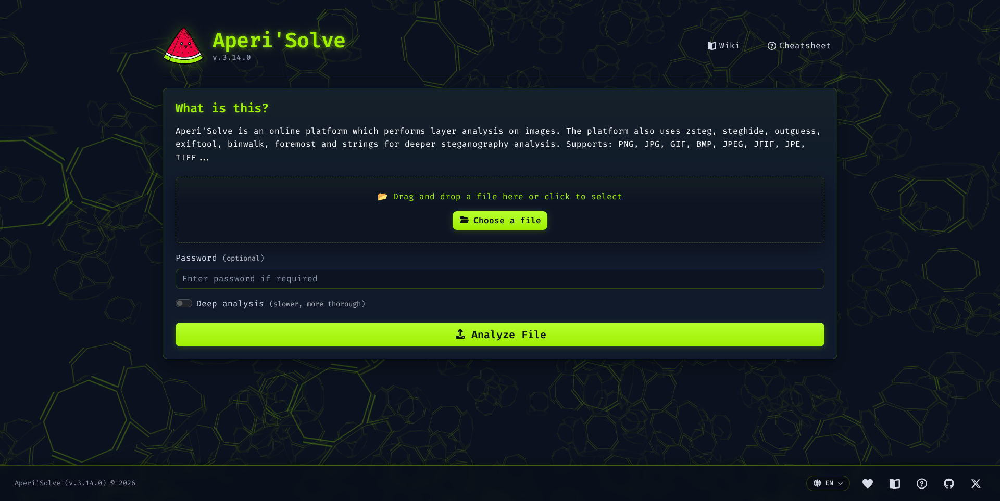
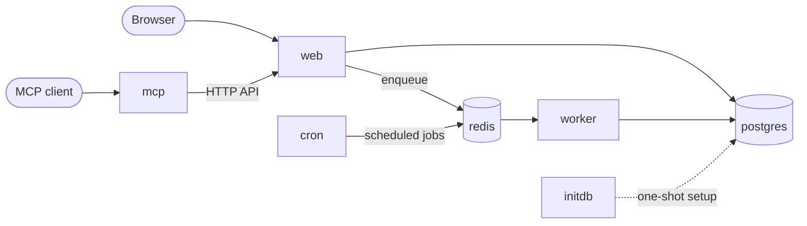

<div align="center">

<a href="https://www.aperisolve.com">
  
</a>

<h1>Aperi'Solve</h1>

<p>Open-source steganalysis platform. Upload a file, get every bit plane<br/>and the output of 21 steganography and forensics analyzers on one page.</p>

<p>
  <a href="https://www.aperisolve.com"><b>Website</b></a> ·
  <a href="https://www.aperisolve.com/wiki/"><b>Wiki</b></a> ·
  <a href="docs/mcp.md"><b>MCP server</b></a> ·
  <a href="https://github.com/Zeecka/AperiSolve/issues"><b>Report an issue</b></a>
</p>

<p>
  <a href="https://www.aperisolve.com"></a>
  <a href="https://github.com/Zeecka/AperiSolve/actions/workflows/release.yml"></a>
  <a href="https://github.com/Zeecka/AperiSolve/actions/workflows/lint.yml"></a>
  <a href="https://github.com/Zeecka/AperiSolve/releases/latest"></a>
  <a href="LICENSE"></a>
  <br/>
  
  
  
  
  
  <a href="https://inventory.raw.pm/tools.html#Aperi'Solve"></a>
</p>

<a href="https://www.aperisolve.com">
  
</a>

<a href="https://github.com/sponsors/Zeecka">
  
</a>

</div>

---

Aperi'Solve is an open-source steganalysis web platform. It runs automated
analysis on an uploaded file to detect and extract hidden data with common
steganography tools and techniques. Images go through every image analyzer,
audio and PDF files through the analyzers written for them, and any file
through the generic ones (file, exiftool, binwalk, foremost, strings). Audio
and video files also get an inline preview.

Try it now: **https://www.aperisolve.com**

## Features

- **Bit planes**: every bit layer (LSB and the others) of every image channel
  (R/G/B/Alpha).
- **Color remapping**: 8 random palette remaps of the image.
- **21 analyzers run in parallel**, picked by the detected file type (see the
  [table below](#analyzers)). Each result has a success / no-result badge, and
  extracted files download in one click.
- **Optional password** passed to the tools that take one, and an optional
  **deep analysis** that adds the slow analyzers.
- **In-app wiki** ([`/wiki`](https://www.aperisolve.com/wiki/)): a
  HackTricks-style steganography handbook with a triage methodology, a
  decision-tree cheatsheet, technique pages per medium (image, audio, text,
  files) and a guide per analyzer, all written in Markdown.
- **Seven languages**: English, French, Spanish, German, Russian, Chinese and
  Portuguese, under language-prefixed URLs (`/fr/`, `/es/`, ...).
- **Ask AI panel** on the result page: sends the analysis results and images
  from your browser to your own LLM provider (bring your own key) and asks what
  is hidden and what to try next.
- **MCP server** at `https://www.aperisolve.com/mcp` ([docs/mcp.md](docs/mcp.md)):
  lets Claude, Cursor or any MCP client upload a file and read its analysis.
- **Worker queue** (Redis + background workers) for the heavy and slow analyzers.
- **Content-addressed result cache**, HTTP caching and per-endpoint rate limiting.
- **Retention**: results stay available for browsing and download for a while,
  then a scheduled job removes them.

<details>
<summary>What the Ask AI panel sends</summary>

<br/>

Two checkboxes pick what the model gets: the images (on by default) and a text
matrix of every image's pixel values (off by default; native resolution, so
text-only models can read LSB data too). The matrix comes from the browser's
image decoder: it is exact for opaque pixels of a PNG/BMP/GIF, but a
semi-transparent pixel can be off by one in a colour channel (the canvas stores
premultiplied alpha), the RGB under a fully transparent pixel reads 0, and JPEG
depends on the decoder.

</details>

## Analyzers

Every analyzer is one class in [`aperisolve/analyzers/`](aperisolve/analyzers/).
An analyzer runs when the detected file type matches its **Runs on** column.
**Password** analyzers receive the optional password, **Deep** analyzers run
only when deep analysis is on, and **Files** analyzers produce a downloadable
archive of what they extracted.

| Analyzer | Runs on | What it reports | Password | Deep | Files |
|---|---|---|:-:|:-:|:-:|
| Bit planes (built-in) | images | every bit plane of every channel | | | |
| Spectrogram (built-in, [ffmpeg](https://ffmpeg.org/)) | audio | a spectrogram per channel and the waveform | | | |
| Color remapping (built-in) | images | 8 random palette remaps | | | |
| [stegoveritas](https://github.com/bannsec/stegoVeritas) | images | filters, colour planes, sharpness and ImageOps variants | | ✓ | |
| [stegoveritas](https://github.com/bannsec/stegoVeritas) frames | animated GIF / APNG | every frame, as images | | | ✓ |
| [file](https://manned.org/file.1) | any file | MIME type and format | | | |
| [pdfinfo](https://poppler.freedesktop.org/) | PDF | document metadata | | | |
| [pdfid](https://blog.didierstevens.com/programs/pdf-tools/) | PDF | counts of risky objects (`/JS`, `/OpenAction`, `/Launch`, `/EmbeddedFile`, ...) | | | |
| [exiftool](https://exiftool.org/) | any file | metadata and geolocation | | | |
| [binwalk](https://github.com/ReFirmLabs/binwalk) | any file | embedded files and archives | | | ✓ |
| [foremost](https://foremost.sourceforge.net/) | any file | carved files | | | ✓ |
| [outguess](https://www.rbcafe.com/software/outguess/) | JPEG | extracted payload | ✓ | ✓ | ✓ |
| [pngcheck](https://www.libpng.org/pub/png/apps/pngcheck.html) | PNG | chunk structure and CRC errors | | | |
| [pcrt](https://github.com/sherlly/PCRT) | PNG | checks and repairs the PNG | | | ✓ |
| [GraphicsMagick identify](http://www.graphicsmagick.org/identify.html) | images | image info and properties | | | |
| [steghide](https://steghide.sourceforge.net/) | JPEG, BMP, WAV, AU | extracted payload | ✓ | | ✓ |
| [jpseek / jphide](https://github.com/h3xx/jphs) | JPEG | extracted payload | ✓ | | ✓ |
| [jsteg](https://github.com/lukechampine/jsteg) | JPEG | LSB extraction | | | |
| [openstego](https://www.openstego.com/) | images | extracted payload | ✓ | | ✓ |
| [zsteg](https://github.com/zed-0xff/zsteg) | PNG | LSB text and data | | | |
| [strings](https://pubs.opengroup.org/onlinepubs/9799919799/utilities/strings.html) | any file | printable strings | | | |

### Adding an analyzer

Adding an analyzer is a single file: subclass `SubprocessAnalyzer`, set a few
class attributes (`name`, `has_archive`, `needs_password`, `deep_only`,
`display_order`, and `accepts` for the file types), and install the tool in the
`Dockerfile`. The worker run list, download allow-list and frontend order are
all derived automatically. See [docs/adding-analyzer.md](docs/adding-analyzer.md).

## Self-hosting

To host your own copy of https://www.aperisolve.com, you need Docker and
Docker Compose.

```bash
git clone https://github.com/Zeecka/AperiSolve.git
cd AperiSolve
cp .env.example .env
docker compose up -d
```

Then open http://localhost:5000/.

Ads and analytics are off by default. Every integration
(`CUSTOM_EXTERNAL_SCRIPT`, `GOOGLE_ADS_TXT`, `SITE_BASE_URL`, Sentry) is opt-in
through the environment variables documented in [`.env.example`](.env.example).
The app never injects ad markup itself: `CUSTOM_EXTERNAL_SCRIPT` loads the
AdSense script and placement is left to Auto ads.

## Architecture



The stack runs as Docker Compose services:

- **web**: the Flask app served by gunicorn (Jinja templates and a vanilla JS
  frontend).
- **worker**: an RQ worker that runs the analyzers for each submission, with
  one thread per tool. Production runs several worker replicas.
- **cron**: an RQ cron scheduler that runs the retention cleanup off the
  request path.
- **initdb**: a one-shot service that creates the tables and pre-fills the
  IHDR CRC recovery database.
- **postgres**: image metadata and submission status.
- **redis**: RQ broker (DB 0) and rate-limiter storage (DB 1).
- **mcp**: the MCP server, which calls the web app's API; bound to
  localhost:5001.
- **sentryproxy**: an egress proxy that only lets traffic through to the
  Sentry host of `SENTRY_DSN` (deny by default).
- **rqdashboard**: queue monitoring, bound to localhost:9181.

The worker keeps the heavy tools (binwalk, foremost, zsteg, ...) away from the
web process, so they never block a request. Identical submissions are
deduplicated by a content hash, and derived images are served with long-lived
immutable HTTP headers, so repeat traffic is cheap.

## Documentation

- [docs/adding-analyzer.md](docs/adding-analyzer.md): add a new analyzer.
- [docs/deploy.md](docs/deploy.md): the tag-driven production deploy flow.
- [docs/mcp.md](docs/mcp.md): the MCP endpoint, with client setup, tool reference and quotas.
- [CONTRIBUTING.md](CONTRIBUTING.md): dev setup, tests, wiki pages and translations.

## Testing

```bash
uv sync --extra dev
uv run pytest -q            # unit tests (no services needed)

# end-to-end analyzer tests through the running app:
docker compose -f compose.dev.yml up -d
uv run pytest tests/test_webapp_analyzers.py -v
```

## Contributing

See [CONTRIBUTING.md](CONTRIBUTING.md). The roadmap lives in the
[issues](https://github.com/Zeecka/AperiSolve/issues).

## Security

> [!WARNING]
> If you discover a security issue, please report it privately to the repository owner instead of opening a public issue.

## Credits

Thanks to donors:
- [Philip Zimmermann](https://github.com/Philip-Zimmermann)
- [Ed Guillory](#)
- [Silje Hollås](#)

Thanks to contributors:
- [Zeecka](https://www.zeecka.fr/) - **(author)**
- [aradhyacp](https://github.com/aradhyacp)
- [Philip Zimmermann](https://github.com/Philip-Zimmermann)
- [abneeeees](https://github.com/abneeeees)

Thanks to the open-source community:
[binwalk](https://github.com/ReFirmLabs/binwalk), [exiftool](https://exiftool.org/), [GraphicsMagick identify](http://www.graphicsmagick.org/identify.html), [foremost](https://foremost.sourceforge.net/), [jsteg](https://github.com/lukechampine/jsteg), [jphide/jpseek](https://github.com/h3xx/jphs), [openstego](https://www.openstego.com/), [outguess](https://www.rbcafe.com/software/outguess/), [pcrt](https://github.com/sherlly/PCRT), [pngcheck](https://www.libpng.org/pub/png/apps/pngcheck.html), [steghide](https://steghide.sourceforge.net/), [strings](https://pubs.opengroup.org/onlinepubs/9799919799/utilities/strings.html), [zsteg](https://github.com/zed-0xff/zsteg), ...
